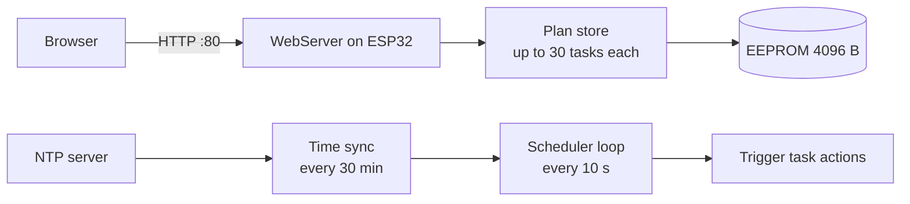

# Task Scheduler for ESP32


A cyberpunk-styled daily task scheduler that runs entirely on an ESP32: NTP-synced clock, several switchable day plans, EEPROM persistence and a browser UI served straight from the board.

## How it works



## Features

- Multiple daily plans, switchable from the UI
- Cyberpunk-themed HTML/CSS interface served on port 80
- NTP time synchronisation with browser time as fallback
- EEPROM-based persistence (4096 bytes, saved after every change)
- Up to 30 task entries per plan

## Hardware and network

- ESP32 development board (e.g. DOIT ESP32 DEVKIT V1)
- 3.3 V supply (USB or external)
- 2.4 GHz Wi-Fi network and internet access for NTP

Wi-Fi credentials live in `wifi_config.h`. Copy it, fill in your own values and keep the real file out of commits.

## Getting started

1. Flash `task_schedule.ino` to the ESP32.
2. Connect to the configured Wi-Fi network.
3. Open the IP address printed in the serial monitor.
4. Create or edit your plans in the browser UI.

## Files

```
task_schedule.ino               # firmware (web server + scheduler)
wifi_config.h                   # Wi-Fi credentials
docs/task_scheduler_documentation.pdf
```

## Roadmap

- Buzzer / LED notifications for due tasks
- OTA updates and plan import / export
- Light / dark theme switch

## License

MIT
